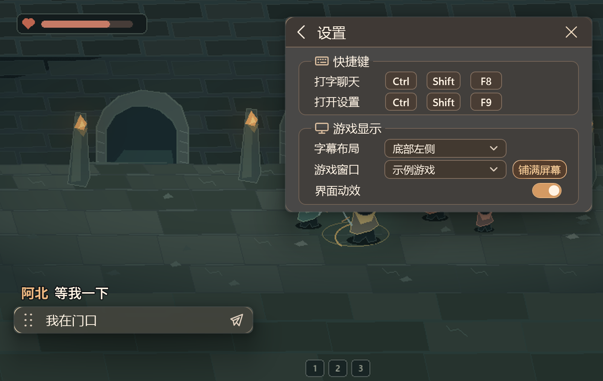

# CampChat 营地聊天

CampChat 是一款轻量的 Windows 游戏文字聊天工具。队友通过局域网或虚拟局域网加入同一个房间。游戏中可以看透明字幕，也可以用快捷键唤醒输入条。

[下载最新版本](https://github.com/heiferleaf/CampChat/releases/latest) · [使用说明](CampChat/README.md) · [变更记录](CHANGELOG.md)



[查看房间界面](docs/room.png)

## 开始使用

1. 下载 Windows x64 ZIP，完整解压后运行 `CampChat.exe`。如系统提示缺少运行时，安装 [.NET 10 Desktop Runtime x64](https://dotnet.microsoft.com/download/dotnet/10.0)。
2. 房主创建房间并选择队友能访问的 IPv4 网卡。局域网选 WLAN 或以太网，异地可使用 Radmin VPN 或 Tailscale 网卡。
3. 房主把房间码发给队友。队友在「加入房间」粘贴房间码并加入。每个房间最多 8 人。
4. 默认按 **Ctrl + Shift + F8** 打字，按 **Enter** 发送或按 **Esc** 收起。默认按 **Ctrl + Shift + F9** 打开设置。两组快捷键都可以改。

## 游戏与显示模式

CampChat 的浮层适用于 Windows 窗口化和无边框全屏。需要将窗口铺满屏幕时，在设置中选中已打开的游戏窗口，再点「铺满屏幕」。点「还原窗口」可恢复边框和位置。独占全屏的显示路径可能盖住桌面浮层。无边框转换的效果取决于所选窗口允许的 Win32 操作。[Microsoft 全屏模式说明](https://devblogs.microsoft.com/directx/demystifying-full-screen-optimizations/)

主窗口支持边缘拖动调整大小。空间较窄时，首页动作会换行。聊天和表单超出显示区域时可以滚动。Windows 11 支持并开启系统透明效果时，主窗口和输入条使用系统 Acrylic 背景。Windows 会根据窗口状态和系统配置退回不透明材质。[Microsoft 系统背景材质说明](https://learn.microsoft.com/windows/win32/api/dwmapi/ne-dwmapi-dwm_systembackdrop_type)

## 数据位置

`CampChat.settings.json` 和写入时的临时文件保存在 EXE 同目录。最近消息只保存在程序运行期间的内存中。程序当前没有独立日志文件。房主监听所选网卡的 TCP 47821，连接使用 TLS，队友通过房间码校验主机身份。

## 从源码构建

需要 Windows 和 .NET 10 SDK。命令在仓库根目录运行。

```powershell
dotnet publish .\CampChat\CampChat.csproj -c Release --self-contained false -p:DebugType=embedded -o .\publish
dotnet run --project .\CampChat.Check\CampChat.Check.csproj -c Release
```

桌面交互检查和独立浮层小样见[贡献指南](CONTRIBUTING.md)。页面及浮层的状态见[界面与交互规格](docs/interaction.md)。本项目使用 [MIT 许可证](LICENSE)。
